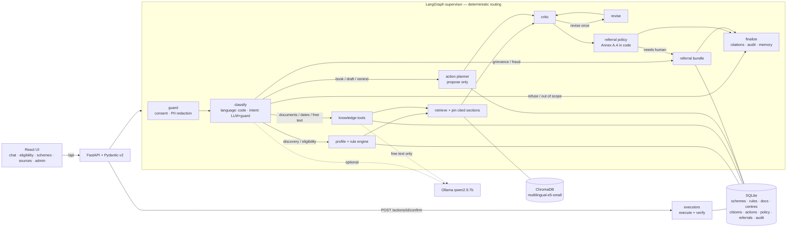

# SchemeSathi — multilingual citizen scheme navigator with verified eligibility

HCLTech Future Ready AI Engineer Hackathon · Use case 4 · fictional state of **Mitrapur Pradesh**.

> All schemes, amounts, offices and people in this project are fictional. Nothing the system says is real advice.

SchemeSathi answers a citizen's question in **Hindi, English, Kannada, Tamil or Hinglish**. It finds the
matching scheme guidelines and circulars and asks only for the details it needs. Eligibility is decided by a
**deterministic rule engine** over SQLite rule tables, never by the language model. The reply comes back in the
citizen's language and script, with citations. A critic checks every draft. Actions follow
**propose → confirm → execute → verify**: the system can prepare a draft application, book a service-centre
visit or set a reminder. When the referral policy requires a human, it hands off to an officer with a full,
PII-redacted bundle.

---

## Contents
1. [Quick start](#1-quick-start)
2. [Architecture](#2-architecture)
3. [How each requirement is met](#3-how-each-requirement-is-met)
4. [API and sample curl commands](#4-api-and-sample-curl-commands)
5. [For judges: live tests](#5-for-judges-live-tests)
6. [Data](#6-data)
7. [Evaluation](#7-evaluation)
8. [Project structure](#8-project-structure)
9. [Assumptions, limitations and known edge cases](#9-assumptions-limitations-and-known-edge-cases)
10. [AI usage, team and declaration](#10-ai-usage-team-and-declaration)

---

## Sign-in and roles

| Role | How to sign in | Can do |
|---|---|---|
| **Citizen (user)** | Citizen ID (e.g. `C1001`) and password `citizen123` | Chat with their own profile (if consent is Y), book visits, draft applications, see **only their own** past conversations and audit records |
| **Admin** | `admin` / `admin123` (hardcoded default; change `ADMIN_PASSWORD` in `.env`) | Everything a citizen can, plus **every citizen's conversations** (filter by citizen), the Admin tab (health, ingest, CSV loader) and `/admin/users` |
| **Guest** | "Continue as guest" | Ask questions and check eligibility; no profile, no actions, no saved history |

* Tokens are HMAC-signed bearer tokens (`POST /auth/login` → `Authorization: Bearer <token>`); passwords are stored as PBKDF2 hashes.
* A signed-in citizen can only act as themselves (a different `X-Citizen-Id` gets 403) and can only open their own conversations and audit records (others return 404, so their existence is not revealed).
* `POST /ingest` and `POST /admin/load` need the admin token. Set `OPEN_ADMIN_ENDPOINTS=true` to open them on a judging laptop.
* For the guide's API contract, `/ask` and the action endpoints still accept a bare `X-Citizen-Id` header (`ALLOW_HEADER_IDENTITY=true`); set it to `false` to require sign-in.
* **Eligibility lists show only actionable schemes:** the Check eligibility page and discovery answers list schemes that *appear eligible*, *need more information* or are *provisional* (officer to verify). Not-eligible and closed schemes are hidden. `POST /eligibility` returns everything by default (the contract) and only actionable schemes with `"include_not_eligible": false`. A direct question about one scheme ("can my mother get the pension?") still gets an honest "not eligible, because…" answer.

```bash
TOKEN=$(curl -s localhost:8000/auth/login -H 'Content-Type: application/json'   -d '{"username":"admin","password":"admin123"}' | python -c "import sys,json;print(json.load(sys.stdin)['token'])")
curl -s localhost:8000/conversations -H "Authorization: Bearer $TOKEN"                    # all conversations
curl -s "localhost:8000/conversations?citizen_id=C1001" -H "Authorization: Bearer $TOKEN" # one citizen
curl -s localhost:8000/ingest -H "Authorization: Bearer $TOKEN" -F file=@backend/data/demo_ingest/CIR-2026-020.md   -F "metadata=$(cat backend/data/demo_ingest/CIR-2026-020.meta.json)"
```

---

## 1. Quick start

### Option A — Docker (what the guide requires)
```bash
cp .env.example .env            # optional; defaults work
docker compose up --build       # API on :8000, UI on :8080
```
* UI: <http://localhost:8080> · API docs: <http://localhost:8000/docs> · health: <http://localhost:8000/health>
* The first start builds the knowledge base (embeds about 75 sources). This takes about a minute on CPU. `/health` reports `ok` when it is done.
* **Ollama on the host** (default): install Ollama, run `ollama pull qwen2.5:7b-instruct` and keep it running.
  The API reaches it at `http://host.docker.internal:11434`. On Linux, compose maps that name for you through `extra_hosts`.
* **Ollama in a container**: `docker compose --profile ollama up --build`, then set `OLLAMA_URL=http://ollama:11434`
  in `.env` and run `docker compose exec ollama ollama pull qwen2.5:7b-instruct`.
* **No LLM at all**: set `MOCK_LLM=true`. Routing, the rule engine, critic, referral and actions all work
  without a model. Classification and free-text answers then use deterministic heuristics.
* If Ollama is unreachable, the API does not fail. It falls back to the heuristics, and `/health` shows `llm.ok=false`.

### Option B — local development
```bash
# backend (Python 3.11 or 3.12)
python -m venv .venv && source .venv/bin/activate          # Windows: .venv\Scripts\activate
pip install torch --index-url https://download.pytorch.org/whl/cpu
pip install -r backend/requirements.txt
cd backend
python scripts/build_kb.py                 # optional: the API also builds on first start
MOCK_LLM=true uvicorn app.main:app --port 8000   # drop MOCK_LLM to use Ollama

# frontend (Node 20+)
cd frontend && npm install && npm run dev  # http://localhost:5173 (proxies /api -> :8000)
```

### Tests and evaluation
```bash
cd backend
python -m pytest -q                 # 44 tests, offline: rule engine, critic, safety, auth, API contract
python eval/run_eval.py             # full evaluation -> eval/report.md, docs/samples/*.json
```

---

## 2. Architecture



**Design in one paragraph.** This is one supervisor graph with plain-code routing, and only two places can
call the LLM: the classifier and the free-text composer. Everything that must be correct is code over SQLite:
eligibility, dates, document lists, centres, referral decisions, action execution, PII redaction, script
detection and the critic's checks. Structured answers (eligibility, documents, deadlines, actions, referrals)
are written by code from tool output, using templates in five languages. Numbers, dates and verdicts are
therefore identical in every language by construction, and the model can never promise a benefit. Retrieval
supplies the evidence and citations. Each cited section is then pinned from the vector store by its exact
source ID and section number. Full rationale, with the trade-offs we would defend in Q&A:
[`docs/architecture.md`](docs/architecture.md).

| Guide role (5.1) | Implemented as | LLM? |
|---|---|---|
| Orchestrator | `app/graph.py` — LangGraph `StateGraph`, conditional edges | no |
| Language & intent classifier | `agents/classifier.py` — script detection + PII + safety signals in code; LLM JSON for intent/attributes, validated, with fallback | optional |
| Profile collector | `graph.eligibility` + `nlp/extract.py` — merges profile (consent Y only), conversation memory and message; at most 2 questions per turn | optional (extraction) |
| Knowledge agent (RAG) | `kb/vectorstore.py` — Chroma, e5 query/passage prefixes, scheme boost, date validity | no |
| Eligibility checker | `rules/engine.py` + `tools.check_eligibility` | **never** |
| Answer composer | `agents/composer.py` — templates for structured answers; LLM only for free-text questions | free text only |
| Critic | `agents/critic.py` + `agents/evidence.py` — numbers vs scheme-scoped evidence, superseded values, caveat, script, PII, promises | no |
| Action planner / referral | `agents/actions.py`, `agents/referral.py` | no |

---

## 3. How each requirement is met

| Req | Where | Notes |
|---|---|---|
| R1 classification | `agents/classifier.py`, `models.IntentOut` | intent, language+script, urgency, sentiment, attributes, PII, tools, confidence, flags; LLM output validated with Pydantic, retried once, code fallback |
| R2 multilingual retrieval | `kb/vectorstore.py` | `intfloat/multilingual-e5-small`; measured per language pair (section 7) |
| R3 citations | `graph._citations` | source ID, section, scheme, effective and updated dates, plus a readable label ("स्रोत: GL-PEN-01, धारा 3") |
| R4 deterministic eligibility | `rules/engine.py` | AND rules plus OR rule-groups, date-valid rule rows, four verdicts, rule-by-rule output |
| R5 progressive questions | `graph.eligibility` | asks only for attributes rules in play need, max 2 per turn (policy `QPT-01`), never repeats, says why, sensitive attributes only when the scheme in focus needs them |
| R6 language fidelity | `i18n.py`, `nlp/lang.py` | reply in the citizen's script; scheme names in local script plus English; numeric DD-MM-YYYY dates and ₹ Indian grouping; Tanglish/Kanglish detected (reply in native script) |
| R7 self-critique | `agents/critic.py` | answer / revise / refer; one revision (`CRT-REV-01`), threshold 0.8 (`CRT-GRD-01`) |
| R8 referral | `agents/referral.py` | Annex A.4 rules in code; Annex D bundle; SLA from policy registry |
| R9 precedence | `tools.scheme_status`, `engine.detect_conflicts`, `kb/effects.py` | circulars extend or close schemes; an amendment newer than the rule rows → `verify_with_officer` and referral; grievances never override guidelines |
| R10 safe actions | `agents/actions.py`, `POST /actions/{id}/confirm` | tiers 1–2 only; drafts always `draft`; idempotent confirm; owner check; expiry |
| R11 consent & PII | `tools.lookup_citizen`, `nlp/pii.py` | profile only from `X-Citizen-Id` and only with consent Y; redaction in answers, bundles, audit and stored messages |
| R12 untrusted content | `kb/effects.contains_instructions`, critic | documents flagged at ingest; authority-5 sources never cited; injection attempts get a fixed reply |
| R13 audit | `GET /audit/{trace_id}` | intent, route, sources, tools, rules, actions, critic, referral, model, latency, tokens; no chain-of-thought |
| R14 live ingestion | `POST /ingest`, `POST /admin/load`, `scripts/load_citizens.py` | used on the next request; extensions and closures are parsed from the circular text |
| R15 evaluation | `eval/` | section 7 |

---

## 4. API and sample curl commands

| Endpoint | Purpose |
|---|---|
| `POST /auth/login` · `GET /auth/me` | sign in (admin / citizen), current user |
| `GET /conversations` | past conversations: own (citizen) or all, `?citizen_id=` filter (admin) |
| `GET /admin/users` | admin: citizens with sign-in and conversation counts |
| `POST /ask` | citizen message (bearer token, or `X-Citizen-Id: guest` / `C1001`) |
| `POST /eligibility` | rule engine only, no LLM |
| `POST /actions/{id}/confirm` · `/cancel` | the only way anything is executed |
| `POST /ingest` | Markdown document or JSON grievance + Source Register metadata |
| `GET /health` · `/conversations/{id}` · `/referrals/{id}` · `/audit/{trace_id}` · `/sources` | as specified |
| extras | `GET /sources/{id}`, `GET /schemes`, `GET /citizens/demo`, `POST /admin/load` (CSV loader) |

```bash
# cited eligibility answer (add "language":"hi"|"kn"|"ta" to force the reply language)
curl -s localhost:8000/ask -H 'Content-Type: application/json' -H 'X-Citizen-Id: guest' \
  -d '{"message":"My mother is 67 and our family income is ₹1.2 lakh a year. Can she get the old-age pension?","as_of_date":"2026-11-21"}'

# multi-turn: pass back the conversation_id from the previous response
curl -s localhost:8000/ask -H 'Content-Type: application/json' -H 'X-Citizen-Id: guest' \
  -d '{"message":"வருமானம் 1.2 லட்சம்","conversation_id":"C-0001"}'

# propose a visit, then confirm it (only the owner can)
curl -s localhost:8000/ask -H 'Content-Type: application/json' -H 'X-Citizen-Id: C1001' \
  -d '{"message":"Book me a slot at the nearest service centre this Saturday and remind me the day before."}'
curl -s -X POST localhost:8000/actions/ACT-0001/confirm -H 'X-Citizen-Id: C1001'

# rule engine directly
curl -s localhost:8000/eligibility -H 'Content-Type: application/json' \
  -d '{"attributes":{"age":60,"annual_household_income":150000},"scheme_ids":["SCH-PEN-01"],"as_of_date":"2026-11-21"}'

# live ingestion of an amendment (extends the Medhavi last date to 2026-12-05)
curl -s localhost:8000/ingest -F file=@backend/data/demo_ingest/CIR-2026-020.md \
  -F "metadata=$(cat backend/data/demo_ingest/CIR-2026-020.meta.json)"

# referral bundle and audit record
curl -s localhost:8000/referrals/RF-0001
curl -s localhost:8000/audit/<trace_id>
```

---

## 5. For judges: live tests

* **Load your citizens and rules** (CSV files named after the Annex C tables: `citizens.csv`, `applications.csv`,
  `appointments.csv`, `eligibility_rules.csv`, `schemes.csv`, `required_documents.csv`, `service_centres.csv`,
  `policy_registry.csv`). Rows are upserted and used on the next request:
  ```bash
  python backend/scripts/load_citizens.py --dir test_citizens/                       # local
  docker compose cp test_citizens api:/app/test_citizens && \
    docker compose exec api python scripts/load_citizens.py --dir /app/test_citizens  # Docker
  curl -F files=@test_citizens/citizens.csv -F files=@test_citizens/eligibility_rules.csv localhost:8000/admin/load
  ```
  The UI's **Admin** tab has the same loader and the ingest form. Loaded citizens appear in the identity picker.
* **Ingest a new document** with `POST /ingest`. The circular parser applies "extended from X to Y" and
  "closed for new applications with effect from D" right away. A circular that changes a limit, when no
  rule row reflects the change, makes the verdict `verify_with_officer` until you load the matching rule row.
* **Dates**: pass `as_of_date` to test any date. The data is built around **2026-11-21** (the Medhavi last
  date is that day; the Suraksha Bima last date was the day before).
* **Reserved IDs** (C9000–C9999, APP-J*, APT-J*, SCH-JD-*, JD-*) are not used in our data.

---

## 6. Data

| Item | Count | Where |
|---|---|---|
| Schemes (6 benefit types, names in en/hi/kn/ta) | 9 | `backend/data/seed/schemes.csv` |
| Eligibility rule rows (OR groups, amended and future rows) | 35 | `seed/eligibility_rules.csv`, every row cites `source_id` + `source_section` |
| Documents (guidelines, translations, policies, circulars, FAQs, process notes, 1 untrusted message) | 49 | `data/kb/docs/` |
| …of which non-English | 26 (hi 9, kn 7, ta 7, mixed 3) | |
| Circulars and amendments (5 change rules, 2 future-dated, 1 closure) | 16 | |
| Resolved grievances (4 needed an officer, 5 outdated) | 26 | `data/kb/grievances/` |
| Service centres across 4 districts | 12 | `seed/service_centres.csv` |
| Policy registry values, each linked to a policy section | 15 | `seed/policy_registry.csv` |
| Synthetic citizens (13 exact edge cases + 25 LLM profiles; 5 with consent N) | 38 | `data/synthetic/` |
| Source Register | 75 rows | `data/source_register.csv` |

Prompts (verbatim), generator, validator and validation output: `data/prompts/`, `scripts/generate_citizens.py`,
`scripts/validate_data.py`, `data/synthetic/validation_report.md`. Data card: [`docs/data_card.md`](docs/data_card.md).

---

## 7. Evaluation

`backend/eval/run_eval.py` → [`backend/eval/report.md`](backend/eval/report.md) (method, all metrics, configuration
comparisons, failures). The report covers answer correctness by category, eligibility accuracy per scheme and
per rule, cross-language verdict and number consistency, citation validity, retrieval hit rate per language pair,
a comparison of three embedding models (bge-m3 is best: 84% vs 71% hit@6; e5-small is the light default), the referral confusion table, question efficiency, critic agreement
under four critic configurations, PII leakage, latency p50/p95 and LLM calls/tokens. Sample artefacts are in
[`docs/samples/`](docs/samples): three audit records, two referral bundles and one recorded action flow.

---

## 8. Project structure

```
schemesathi/
├── docker-compose.yml  .env.example  README.md
├── backend/
│   ├── app/
│   │   ├── main.py            FastAPI endpoints (Section 6 contract)
│   │   ├── graph.py           LangGraph orchestration, citations, audit
│   │   ├── models.py          Pydantic v2 API + LLM schemas
│   │   ├── tools.py           deterministic tools over SQLite
│   │   ├── rules/engine.py    rule engine
│   │   ├── agents/            classifier, composer, critic, evidence, referral, actions
│   │   ├── kb/                vector store, ingestion, circular-effect parser
│   │   ├── nlp/               language detection, attribute extraction, PII
│   │   ├── i18n.py            reply templates in en/hi/kn/ta/hinglish
│   │   ├── llm.py             Ollama client (JSON, validation, retry, mock)
│   │   └── loader.py, db.py, memory.py, config.py
│   ├── data/                  seed tables, knowledge base, synthetic citizens, prompts, demo fixtures
│   ├── scripts/               build_kb, load_citizens, generate_citizens, validate_data
│   ├── eval/                  labelled sets, runner, report
│   └── tests/                 pytest suite
├── frontend/                  React + TypeScript UI (Vite), Dockerfile + nginx
└── docs/                      architecture, data card, AI usage, team statement, demo script, samples
```

---

## 9. Assumptions, limitations and known edge cases

**Assumptions**
* Household attributes (income, district, residence, category, land) carry over when a citizen asks about a
  family member. Personal attributes (age, gender, occupation, disability) do not.
* "Today" is the real date unless `as_of_date` is sent. Booking lead time is measured from the current time of
  day on that date.
* A discovery list may include a provisional (`verify_with_officer`) scheme without creating a referral. A
  referral is created when the citizen asked about that scheme specifically, which avoids over-referral.
* Tanglish/Kanglish questions are answered in Tamil/Kannada script. If both languages are equally likely,
  the assistant asks which language to reply in.

**Limitations**
* **Ollama was not available in the environment where this was built.** The LLM path (JSON classification,
  free-text answers) is implemented with validation and fallback but was exercised only in `MOCK_LLM` mode.
  Run `MOCK_LLM=false python eval/run_eval.py` with Ollama before the demo and compare.
* **Docker was not available in the build environment either.** `docker compose up --build` must be tried once
  before judging.
* Cross-lingual retrieval for **Kannada→English and Tamil→English is weak** with the small e5 model; see the
  per-pair table in the report. Structured answers do not depend on it. Free-text answers in kn/ta rely on the
  translated summaries in the knowledge base.
* Without an LLM, understanding relies on multilingual keyword lexicons. Unusual phrasing can be missed,
  in which case the system asks a question or answers `not_found` rather than guessing.
* Hindi, Kannada and Tamil documents and templates were AI-generated. They need a native-speaker review
  (record it in the data card).
* Reminders are stored, not delivered. Centre capacity per slot is not modelled.
* The evaluation set was written by the team and used during development. It measures regressions more
  than generalisation.

**Known edge cases handled:** income exactly at a limit and one rupee over; age exactly at the minimum and one
day short (age from date of birth on `as_of_date`); land exactly at a cap; OR-group eligibility; an amendment
replacing one clause from its effective date; a future-dated limit announced but not applied; last date today
and yesterday; a scheme closed by circular; an amendment not yet in the rule tables; an already-applied or
rejected application before drafting; an application pending beyond 45 days; consent N; another person's
data; secrets in the message; injected instructions in messages and documents; and "yes confirm" typed instead
of pressing Confirm.

---

## 10. AI usage, team and declaration

* AI-usage disclosure: [`docs/ai_usage.md`](docs/ai_usage.md)
* Team contribution statement and signed declaration of original work: [`docs/team_contribution.md`](docs/team_contribution.md)
  (**every member must fill in and sign before the code freeze**)
* Demo plan for the 10-minute slot: [`docs/demo_script.md`](docs/demo_script.md)